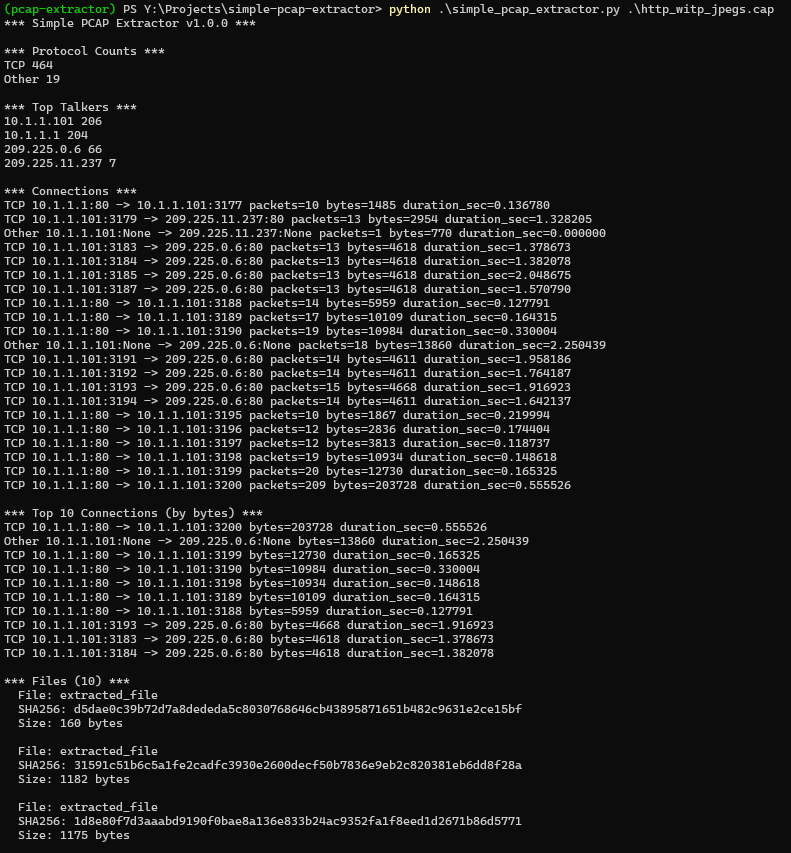

# Simple PCAP Extractor
[](https://github.com/philipzangara/simple-pcap-extractor/actions/workflows/mypy.yml)

A command-line tool for extracting network metadata and file artifacts from PCAP files. Built for SOC analysts who need quick visibility into capture files without opening Wireshark.

## Features

- Protocol breakdown by packet count
- Top talkers by source IP
- Bidirectional connection tracking with packet count, byte count, and duration
- Top 10 connections ranked by bytes transferred
- HTTP file extraction with MD5, SHA256, MIME type detection, and file size
- Terminal and JSON output modes
- Static type checking with MyPy
- Automated CI validation with GitHub Actions

## Requirements

- Python 3.10+
- Windows: `python-magic-bin`, `scapy`
- Linux/Mac: `python-magic` + libmagic (`apt install libmagic1` or `brew install libmagic`), `scapy`

## Installation

```bash
git clone https://github.com/philipzangara/simple-pcap-extractor
cd simple-pcap-extractor
pip install -r requirements.txt
```

Note: `requirements.txt` uses `python-magic-bin` which is Windows only. Linux/Mac users should install `python-magic` instead.

## Running Tests

```bash
pip install -r requirements-dev.txt
python -m pytest tests/
```

## Usage

```bash
# Terminal output
python simple_pcap_extractor.py capture.pcap

# JSON output
python simple_pcap_extractor.py capture.pcap --output json
```

Supports `.pcap` and `.cap` files.

## Screenshot



## Output

**Terminal mode** prints six sections: protocol counts, top talkers, all connections, top 10 connections by bytes, and extracted files with hashes.

**JSON mode** outputs a single object with the same data. Useful for piping into other tools or ingesting into a SIEM.

## Design Notes

Packets are processed one at a time using Scapy's `PcapReader`. This keeps memory usage flat regardless of file size.

Connections are tracked as bidirectional. A packet from `A:1234 → B:80` and a reply from `B:80 → A:1234` map to the same connection entry.

HTTP file extraction pulls response bodies from packets with an `HTTPResponse` layer. Files are identified by MIME type using magic bytes, not file extension. MD5 and SHA256 are computed for each extracted body.

## Sample Captures

Test captures used during development came from the [Wireshark Sample Captures wiki](https://wiki.wireshark.org/SampleCaptures). The `http_with_jpegs.cap` file was used to validate HTTP file extraction.

## Engineering Practices

This repository follows modern software engineering practices:

- Static analysis with MyPy
- Automated CI/CD with GitHub Actions
- Type-safe connection normalization
- Cross-platform dependency management

## Part of the Simple Tools Series

- [Simple Phishing Analyzer](https://github.com/philipzangara/simple-phishing-analyzer)
- [Simple IOC Lookup](https://github.com/philipzangara/simple-ioc-lookup)
- [Simple Log Parser](https://github.com/philipzangara/simple-log-parser)
- Simple PCAP Extractor

## Code Quality

This project uses automated quality controls:

- MyPy static type checking
- GitHub Actions continuous integration
- Validation on every push and pull request
